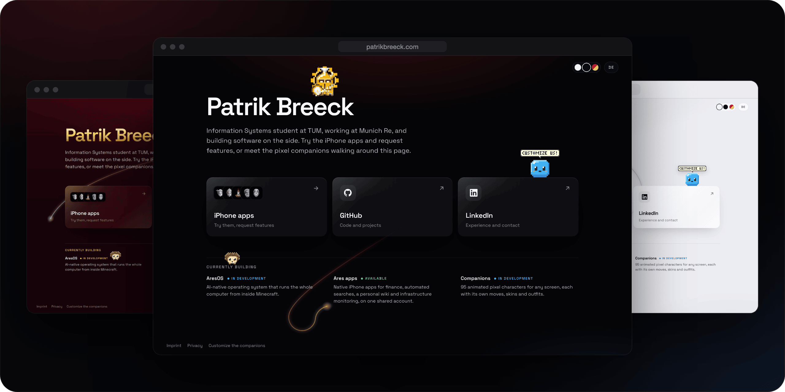
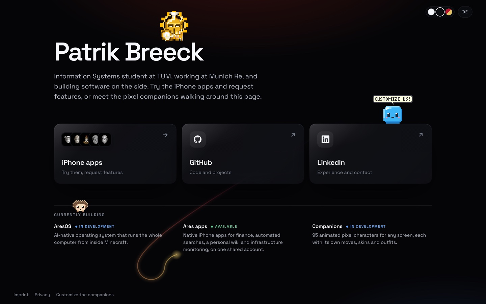
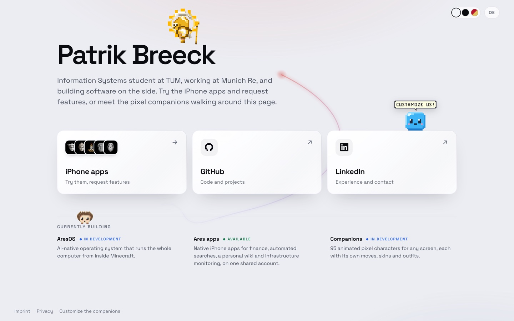
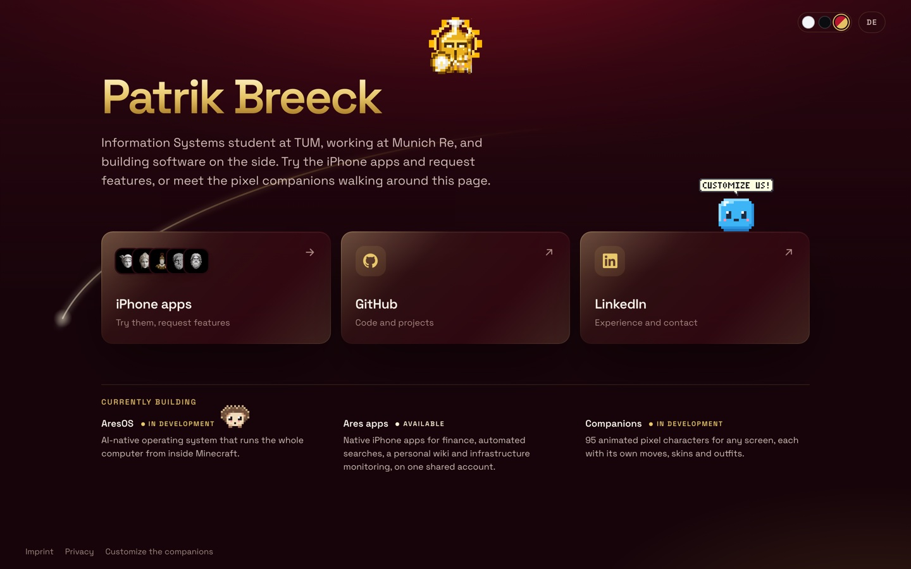
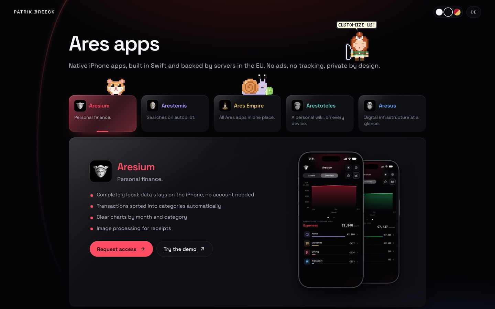
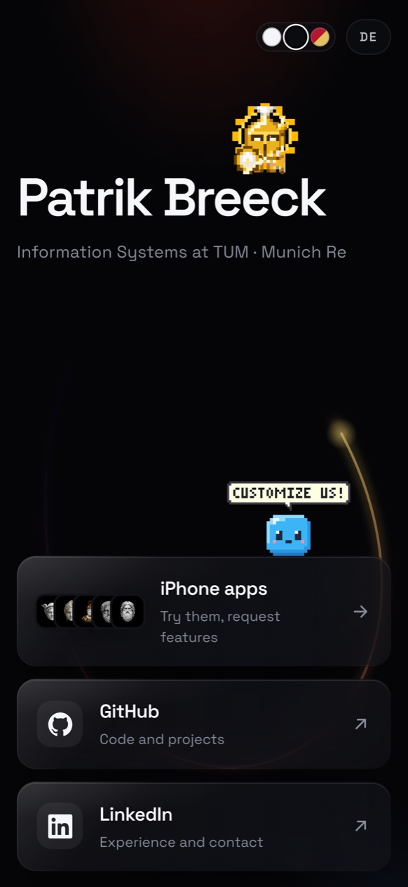

<p align="center">
  
</p>

# patrikbreeck.com

The source of **[patrikbreeck.com](https://patrikbreeck.com)**: a hand-built static site in English and German, with
three looks and pixel companions that live on the page.

## What it does

- **Three looks.** Dark (the default), light, and red and gold, switched in the header. Every colour is a token per
  look, and a slow line of light drifts behind each page.
- **Two languages.** Every page in English and German. The build stops when a text exists in only one of them.
- **The iPhone apps.** The apps page presents the five [Ares iPhone apps](https://github.com/Ares-Empire/empire-ios),
  one card each, with their screens.
- **Pixel companions.** Small characters walk along the page, find edges to stand on and never cover text. Visitors
  choose who appears and how they look.
- **Private by design.** No cookies, no analytics, nothing loaded from another host (fonts included), and a strict
  Content-Security-Policy.
- **No framework.** One Python script, standard library only, builds every page. Node only bundles the companions.

## Screenshots

| Dark | Light | Red and gold |
|:---:|:---:|:---:|
|  |  |  |

<table>
  <tr>
    <td width="72%"></td>
    <td></td>
  </tr>
  <tr>
    <td align="center">The apps page</td>
    <td align="center">On a phone</td>
  </tr>
</table>

## How it's built

| Path | What it is |
|---|---|
| `content/` | Every text in both languages, the links, the apps page and the legal pages. |
| `static/` | The stylesheet, the look switcher, the background line, the apps page and the companions' menu. |
| `vendor/companions` | The companions, a git submodule pinned to one commit. |
| `build.py` | Builds `dist/` from the above. |
| `tools/` | A local server with the production Content-Security-Policy, screenshots, link preview cards. |

The server builds the site with `deploy.sh` and Caddy serves the result.

## Run it locally

```sh
git submodule update --init               # the companions (their repository is not public yet)
npm ci --prefix vendor/companions/web     # esbuild, to bundle them
python3 tools/check-owner.py              # builds dist/ with made-up owner details
python3 tools/serve.py                    # http://127.0.0.1:8790/en/
```

The imprint and privacy policy need the site owner's name and address, which live in a small file outside the
repository; `tools/check-owner.py` uses made-up ones. Everything else is in
[docs/DEVELOPMENT.md](docs/DEVELOPMENT.md): the layout, the apps page, the companions and the link previews.
